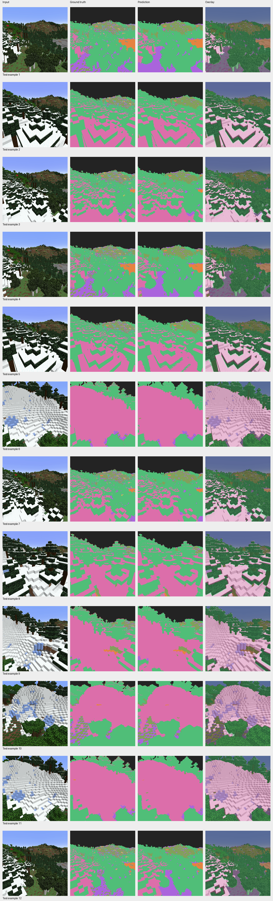
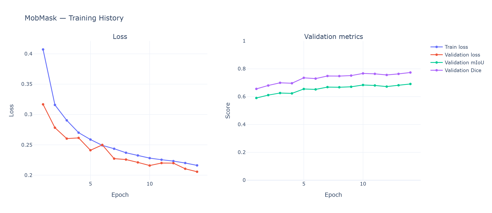
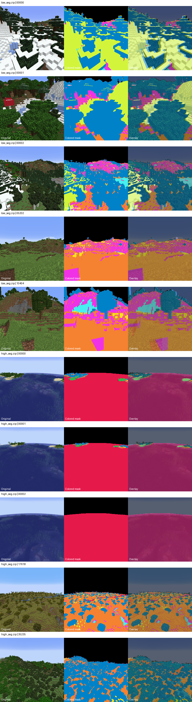
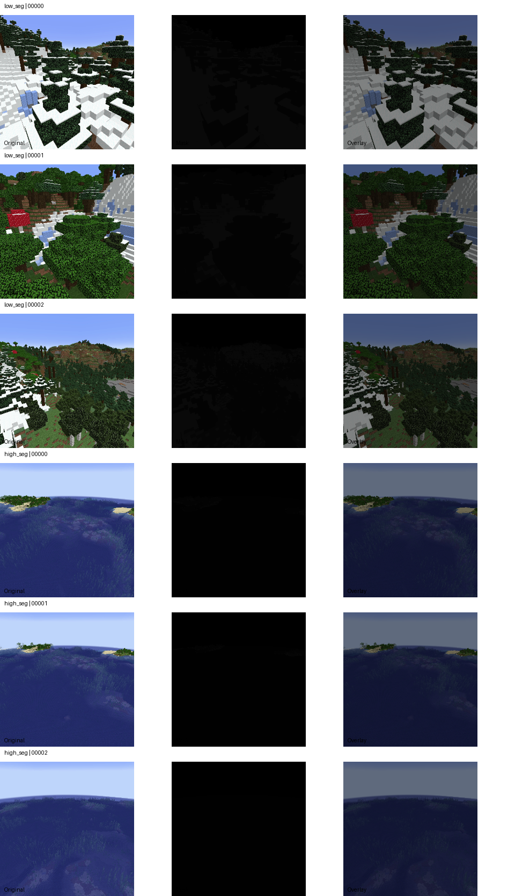

# MobMask — Minecraft Semantic Segmentation

MobMask trains a U-Net model to perform pixel-wise semantic segmentation on Minecraft terrain screenshots. It predicts one of 11 numeric label IDs for every pixel.

> **Status:** A baseline was trained and evaluated. The best saved checkpoint is from epoch 14. The configured 50-epoch run was manually interrupted, so this README reports the actual checkpoint rather than claiming 50 epochs completed.

## Results

| Test metric | Result |
|---|---:|
| Test images | 4,562 |
| Checkpoint epoch | 14 |
| Mean IoU | **0.6884** |
| Mean Dice | **0.7708** |
| Pixel accuracy | **0.9315** |
| Test loss | 0.2074 |
| Model-forward latency | 5.25 ms/image |
| Model-forward throughput | 190.38 images/second |

Timing measures model-forward execution only, excluding image loading, preprocessing, postprocessing, and file I/O. Pixel accuracy should be interpreted alongside IoU and Dice.

## Visual results









These images should exist at the listed paths in the project. Remove any image link if its corresponding local figure is absent.

## Model

- Architecture: U-Net with double-convolution blocks
- Framework: PyTorch
- Parameters: 7,763,371
- Input: RGB image resized to 256 × 256
- Output: 11-class pixel-wise prediction
- Optimizer: AdamW
- Learning rate: 0.001
- Weight decay: 0.0001
- Loss: Cross-entropy
- Scheduler: ReduceLROnPlateau
- Best checkpoint: `checkpoints/mobmask_unet_best.pt`

## Dataset

Source: [`klima7/minecraft-segmentation`](https://huggingface.co/datasets/klima7/minecraft-segmentation)

The manifest contains 45,641 valid image/mask pairs:

| Split | Images |
|---|---:|
| Train | 36,526 |
| Validation | 4,553 |
| Test | 4,562 |
| **Total** | **45,641** |

Images and masks are 256 × 256. Masks use label IDs 0–10. **The official semantic class names have not been verified**, so this project reports numeric IDs instead of guessing names.

### Data limitations

The dataset audit found 183 groups of exact-duplicate images, including 175 groups with inconsistent masks. These conflicts introduce annotation noise and limit how confidently performance can be interpreted. Metrics describe agreement with the supplied annotations, which may themselves be inconsistent. The visualization palette is arbitrary and does not define class meanings.

## Workflow

1. Prepare and validate image/mask pairs and generate a manifest.
2. Audit labels, duplicate images, and mask conflicts.
3. Train the U-Net baseline.
4. Evaluate test loss, pixel accuracy, mean IoU, mean Dice, and per-class metrics.
5. Generate training curves and test prediction figures.
6. Run inference on a test image.

## Setup

Use Python 3.11 and install the dependencies used by the project. If `requirements.txt` exists:

```bash
pip install -r requirements.txt
```

Install a compatible PyTorch build for your hardware if needed. The training run used CUDA. Keep dataset archives, checkpoints, and generated runs out of version control.

## Reproduce

Run from the project root, as applicable:

```bash
python src/prepare_dataset.py
python src/analyze_duplicates.py
python src/analyze_mask_labels.py
python src/inspect_dataset.py
python src/inspect_masks.py
python src/train_segmentation.py
python src/plot_training.py
python src/evaluate_segmentation.py
python src/predict.py
```

Some analysis scripts depend on reports generated by earlier scripts. Training may take substantial time on a laptop GPU. The reported checkpoint is from epoch 14; these results do not imply that the full 50-epoch run completed.

### Inference

`src/predict.py` automatically selects the first test entry in `data/processed/manifest.csv`, loads the image from its ZIP archive, and runs the saved checkpoint:

```bash
python src/predict.py
```

Expected outputs:

- `runs/predictions/test_prediction_mask.png`
- `runs/predictions/test_prediction_overlay.png`

## Per-class test metrics

Class names are unverified, so numeric IDs are used.

| Label ID | IoU | Dice |
|---:|---:|---:|
| 0 | 0.9857 | 0.9928 |
| 1 | 0.9605 | 0.9799 |
| 2 | 0.9131 | 0.9546 |
| 3 | 0.8201 | 0.9011 |
| 4 | 0.4044 | 0.5759 |
| 5 | 0.8357 | 0.9105 |
| 6 | 0.3092 | 0.4723 |
| 7 | 0.8458 | 0.9165 |
| 8 | 0.6298 | 0.7729 |
| 9 | 0.8114 | 0.8959 |
| 10 | 0.0562 | 0.1064 |

The low scores for IDs 6 and 10 show that aggregate metrics conceal substantial class-level variation.

## Future improvements

- Verify the official semantic label mapping.
- Investigate inconsistent annotations.
- Add checkpoint-resume support and compare longer training against the epoch-14 baseline.
- Improve weak per-class results and evaluate on additional screenshots.
- Measure end-to-end inference latency.

## Summary

MobMask demonstrates a complete semantic-segmentation baseline: dataset validation, split-aware duplicate handling, U-Net training, quantitative evaluation, visual predictions, and local inference, with results and limitations documented transparently.
